# WRX Race HUD

Android 15+ race instrument / HUD for **2022-present Subaru WRX (VB / FA24)** using an **OBDLink MX+**.

Mount the phone in the car and the app shows a full-screen tachometer with shift lights, calculated gear, GPS speed, temperatures, boost, AFR, battery voltage, a G-force gauge and warning lamps. It reads engine data over classic Bluetooth from the adapter, can drive a simple Android Auto screen, records CSV logs, and has a built-in simulator so you can try it without a car. It does not flash or calibrate anything; the only command that changes something in the car is the standard "clear trouble codes", after you confirm it.

NOTE: Version 1.0.0 is a rewrite that has **not yet been car-tested** (or tested on a phone), so some things may not work. [v0.33.0](https://github.com/OverclockedWRX/AndroidWRXOBDII/releases/tag/v0.33.0) is still available. Feel free to fork the code and fix anything that's broken.

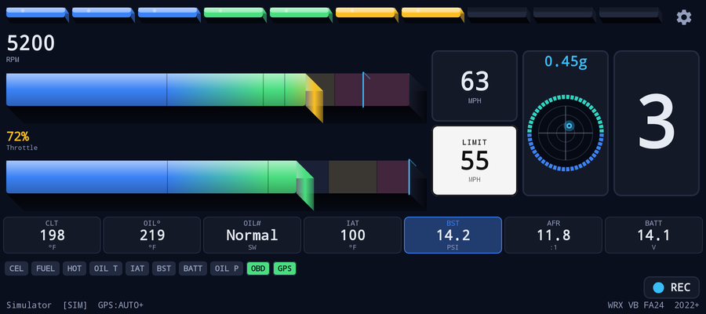

All screenshots are rendered by the JVM screenshot tests with simulator values (not photos of a device or car).

## Features

- First-run setup wizard (permissions requested only on the last step)
- Full-screen instrument display with four tach / shift light styles: 3D bar, Liquid, RPM+Boost helix, Race segments
- Eight color themes: Dark / Modern (default), Light, High contrast, OLED Black, Claude, Handheld, Night, Retro LCD
- Motion setting: **Full**; **Reduced** (no liquid / helix loops, gear flip or shift-light and Danger to Manifold strobes); **Off** (also no bar smoothing or flashing alarm tiles). Until you pick one it follows Android's animation setting
- **Fast** polling (multi-PID requests and response-count hints, the default) or **Legacy** polling (one PID per request) if a gauge misbehaves; switches live, with a poll rate panel under Settings > Vehicle Info
- Auto-reconnect to the adapter with increasing delays (1, 2, 4, 8, then 15 seconds)
- GPS speed: built-in GNSS, Bluetooth NMEA dongle, or USB serial GPS (Auto / forced in Settings)
- Calculated gear (6MT or SPT/CVT ratios + tire size)
- Toggleable gauges: RPM, throttle, speed, gear, coolant, oil temp, oil pressure (user-mapped), IAT, boost/vacuum, AFR (λ×14.7), battery
- Warning lamps: CEL, low fuel, temps, overboost, battery, OBD/GPS link; adjustable alarm thresholds and shift points
- G-force / attitude gauge with in-car mount calibration
- Optional posted speed limit from OpenStreetMap (off by default)
- CSV data logging: tap **REC** on the HUD; files are saved in the phone's Download folder
- PID scanner: discover Mode 01 / Mode 22 outputs and map them to gauges, with a PID scan log
- Trouble code reader, with user-confirmed clear
- Android Auto template screen (see [below](#android-auto))
- Simulator mode for trying the app without a car

## Screenshots

### Themes

| | |
| --- | --- |
| **Dark / Modern**<br> | **Light**<br>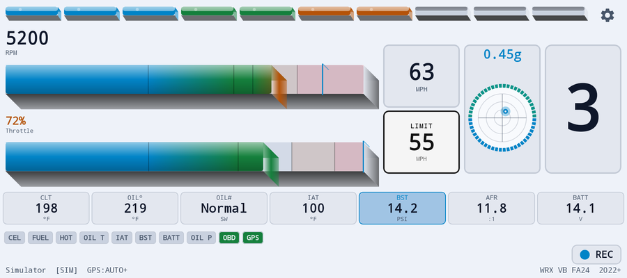 |
| **High contrast**<br>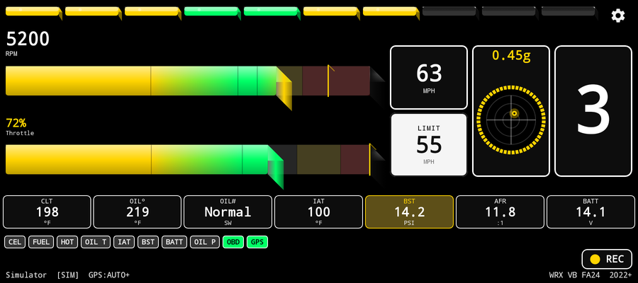 | **OLED Black**<br>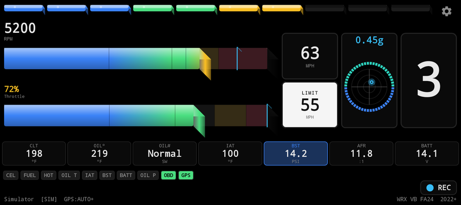 |
| **Claude**<br>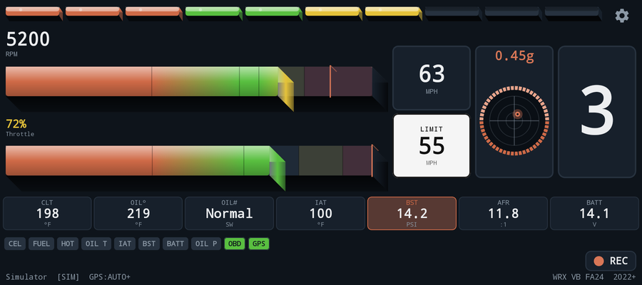 | **Handheld**<br>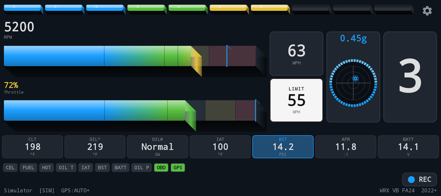 |
| **Night**<br>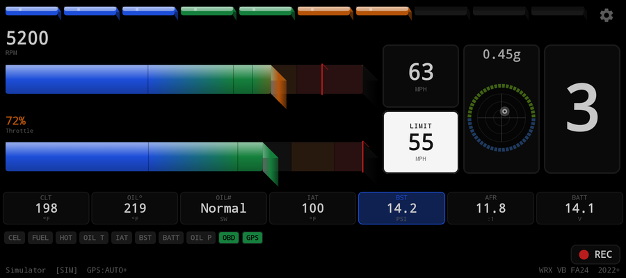 | **Retro LCD**<br>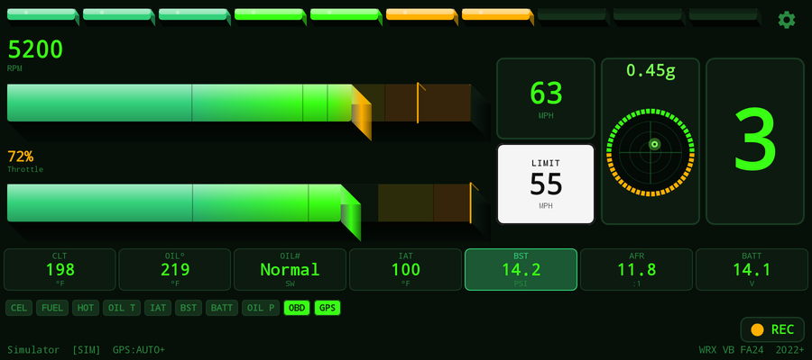 |

### Tach and shift light styles

| | |
| --- | --- |
| **3D bar**<br> | **Liquid**<br>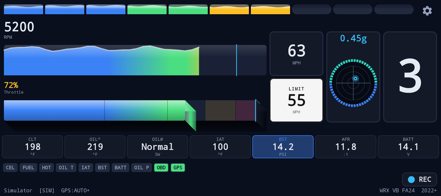 |
| **RPM+Boost helix**<br>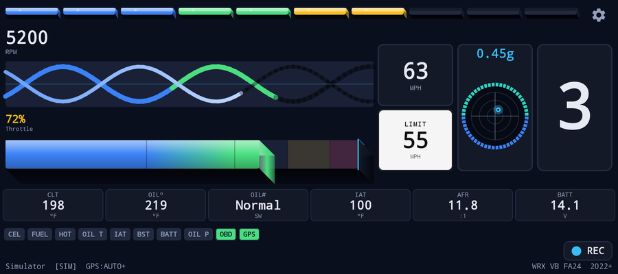 | **Race segments**<br>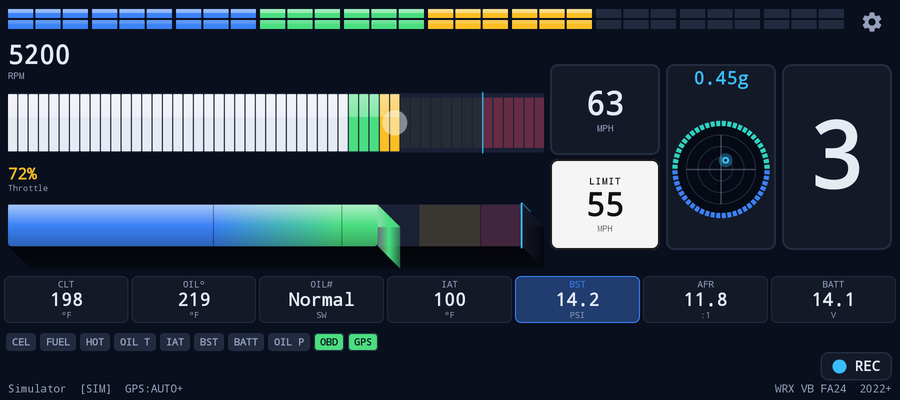 |

### Setup and settings

| | |
| --- | --- |
| **Setup wizard**<br>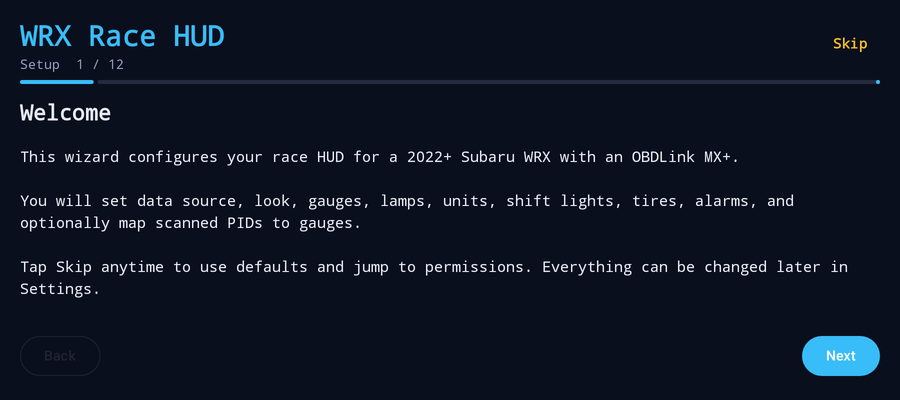 | **Appearance**<br>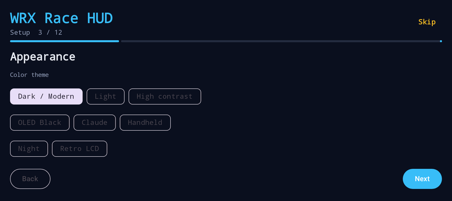 |
| **Mount calibration**<br>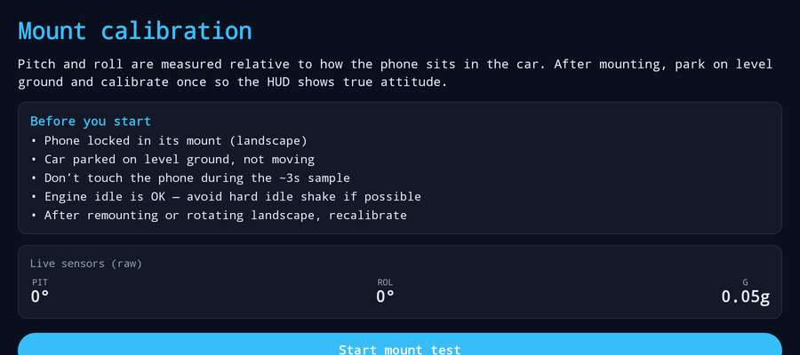 | **Source and polling mode**<br>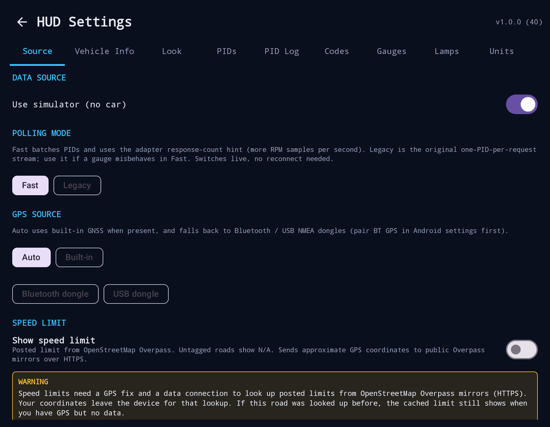 |
| **Look and motion**<br>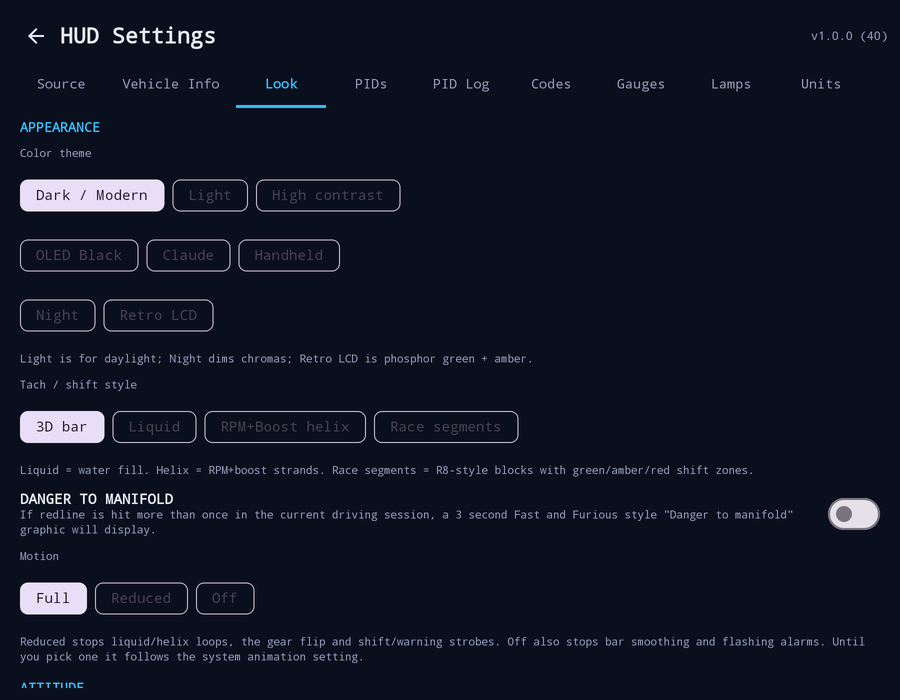 | **Vehicle info and poll rate**<br>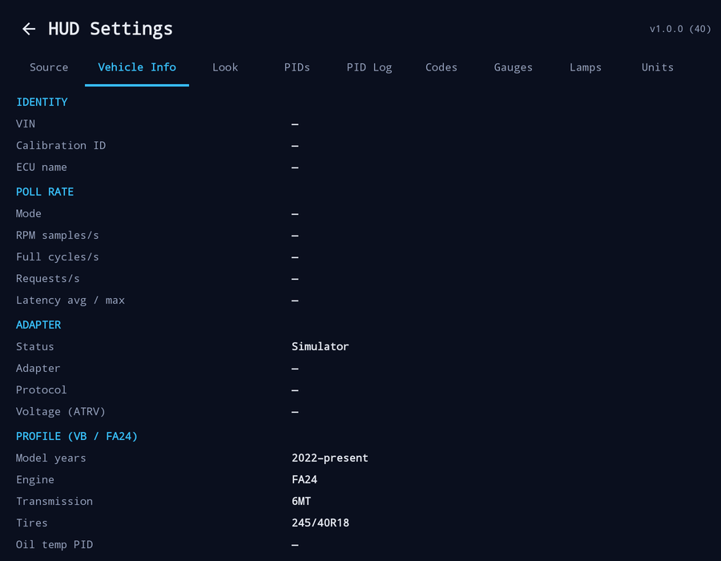 |
| **Gauges**<br>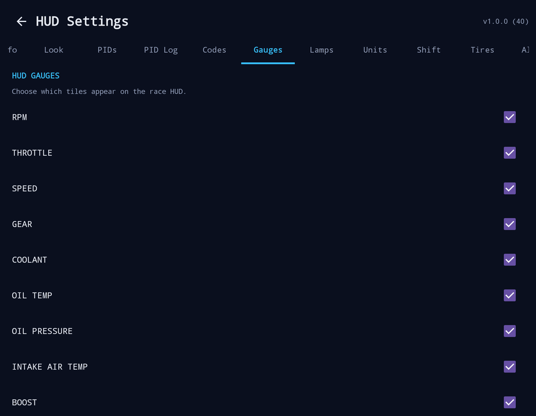 | |

## Requirements

- Android 15 (API 35) or higher
- OBDLink MX+ paired over classic Bluetooth
- Location permission for GPS speed
- Bluetooth connect permission for the adapter

## Install

1. Download `app-debug.apk` from **[GitHub Releases](https://github.com/OverclockedWRX/AndroidWRXOBDII/releases)** on the phone.
2. Coming from a 0.x build? Uninstall it first: 1.0.0 is signed with a different debug key, so it cannot update in place (settings are reset).
3. Open the APK and allow installs from that source when Android asks.

## First run

1. Launch **WRX Race HUD** and complete the setup wizard (data source, look, gauges, lamps, units and more).
2. On the last wizard page, grant Bluetooth / location / notification permissions.
3. Run the mount calibration with the phone in its mount and the car parked on level ground.
4. Pair the OBDLink MX+ in Android Bluetooth settings if using a live car.
5. Turn **off** simulator mode under Settings > Source to connect live.
6. Android Auto: see below. Car App Library apps do **not** appear from a plain sideload.

## Privacy

- Speed-limit lookup is off by default. Only when you turn it on, the app sends your GPS coordinates over HTTPS to the OpenStreetMap Overpass servers (overpass-api.de and lz4.overpass-api.de) to find the posted limit.
- CSV logs and PID scan logs are written to the phone's storage and are not uploaded by the app. CSV logs hold driving data (speed, G-forces, engine values) but no GPS coordinates; check logs before sharing.
- With speed-limit lookup on, recent results and their coordinates are cached on the phone.
- Android cloud backup is disabled for the app.
- The release APK is a debug build, so debug messages (which can include vehicle details) are written to the Android system log.

## Build

Open the project in a current Android Studio (unit tests need JDK 21) or:

```bash
./gradlew :app:assembleDebug
```

The APK is written to `app/build/outputs/apk/debug/`. APKs are not committed to git.

## Android Auto

The app includes a template HUD (`WrxCarAppService` / `HudCarScreen`) for Android Auto.

**Why it may not show on the car screen**

Google only launches **Car App Library** apps that were installed from a *trusted source* (Play Store, Internal Testing track, or Internal App Sharing). The Android Auto “Unknown sources” developer option does **not** apply to these apps — so an `adb install` debug APK will run on the phone but typically never appear in the AA launcher.

**What to do for the WRX head unit**

1. Upload the APK via [Play Console → Internal app sharing](https://play.google.com/console/about/internalappsharing/) or an Internal Testing track (private app is fine).
2. Install that shared build on the phone (not the adb APK).
3. Enable Android Auto developer mode (About → tap Version 10×) if you need DHU / extra options.
4. Connect AA and open **WRX Race HUD** from the launcher.

Play Console prep (foreground-service declarations, location, Car App category): see [docs/PLAY_CONSOLE.md](docs/PLAY_CONSOLE.md).

**Desktop Head Unit (DHU)** can run the adb debug build for UI testing without Play.

## Vehicle notes

| Channel | Source |
| --- | --- |
| RPM, coolant, IAT, MAP/boost, voltage, MIL, fuel % | SAE Mode 01 |
| Speed (display) | Phone GPS |
| Gear | Calculated from OBD speed + RPM + WRX ratios |
| Oil temp | Auto-probed: Mode 01 `5C`, then Mode 22 `0113` / `1153` (header `7E0`) |
| Oil pressure | Not available (VB has a switch only, no PSI sensor on OBD) |
| Coolant vs “water temp” | Same ECT sensor on FA24 (one Coolant tile) |

## Confirming oil-temp DIDs

On connect the app tries each oil-temp source and keeps the first reply that decodes to a plausible temperature (−20…160 °C). The footer shows `OIL:01 5C`, `OIL:22 0113`, or `OIL:none`.

To confirm manually with an MX+ terminal (or Torque custom PID test):

1. Pair the adapter, ignition ON / engine running.
2. Init: `ATZ`, `ATE0`, `ATH0`, `ATSP6`, `ATSH7E0`.
3. Try `015C` — expect `41 5C XX` → temp = XX − 40 °C.
4. If that fails, try `220113` then `221153` — expect `62 …` with data byte(s); scale is typically A−40 °C.
5. Cross-check against a known-good oil temp (Accessport / another gauge). If the live value tracks within a few degrees, that DID is confirmed — tell us and we hard-code it as the primary.

`adb logcat -s ObdPoller` also prints each probe reply during connect.

## License

MIT. See [LICENSE](LICENSE).
